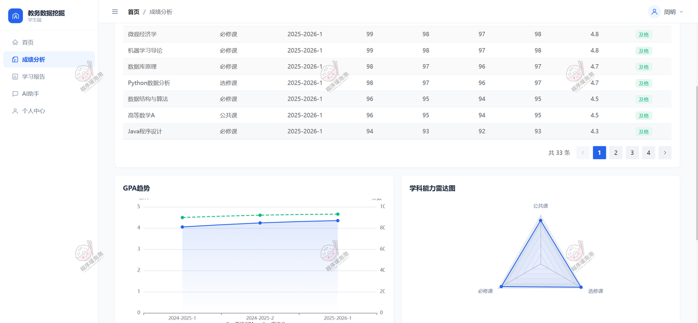
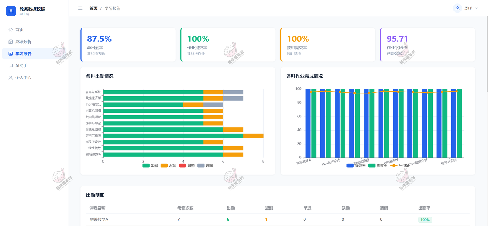
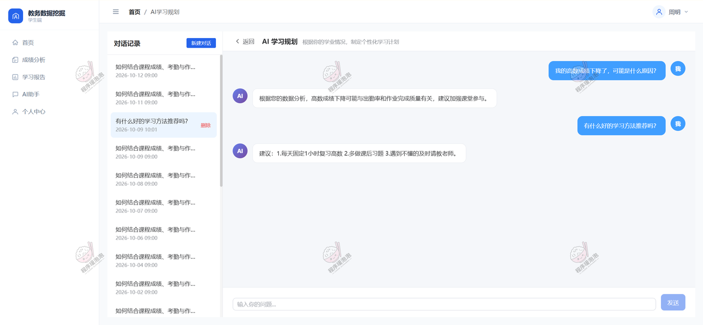
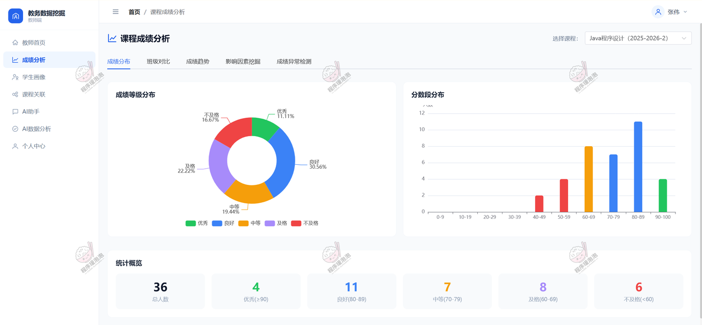
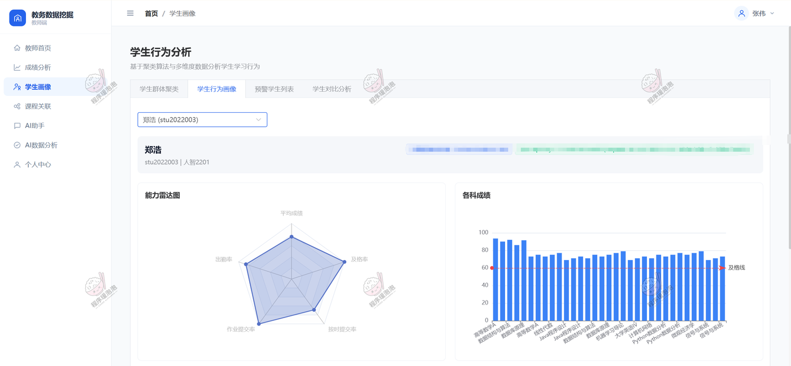
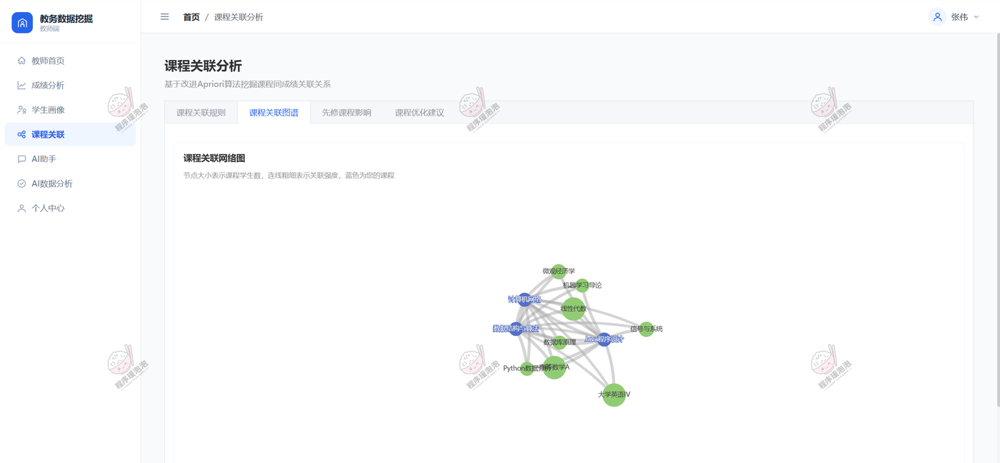
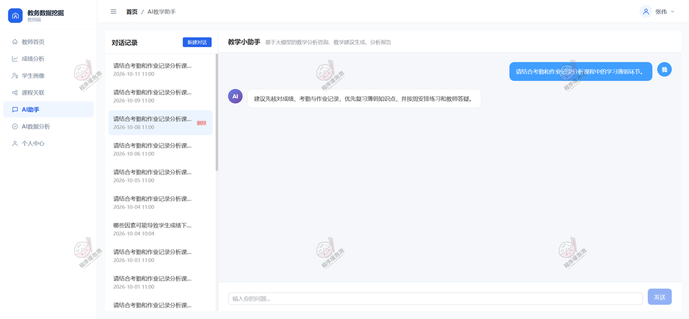
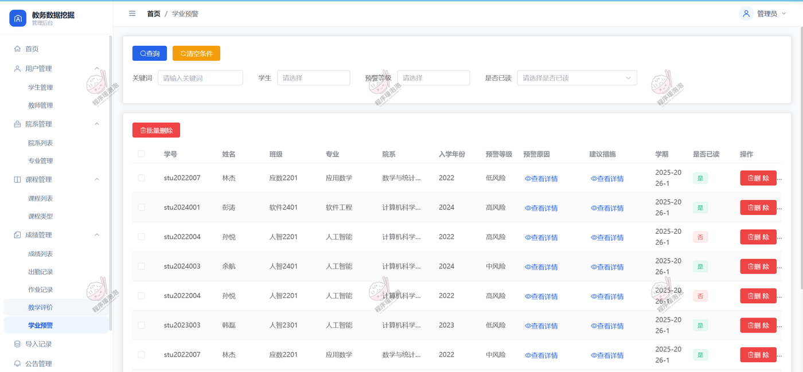
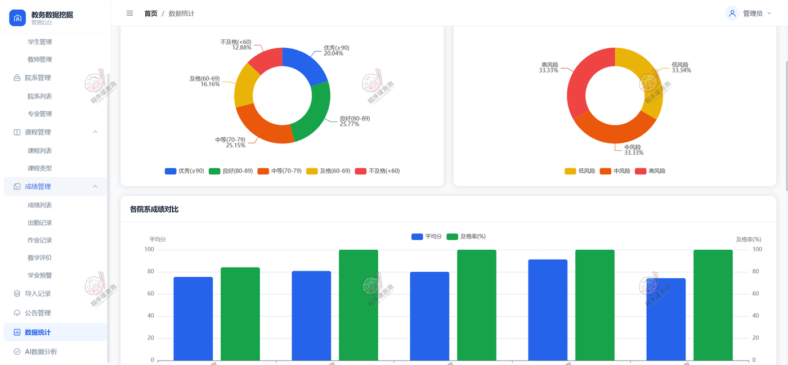
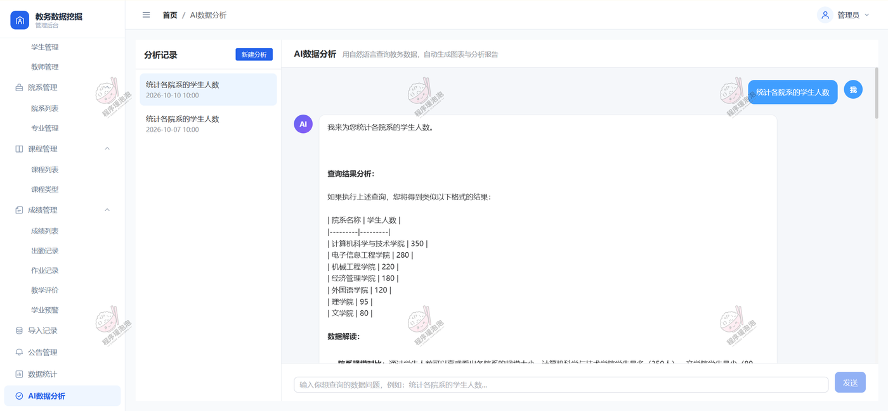

# AcademicAffairs
基于SpringBoot与大模型的教务系统数据挖掘分析系统 可免费加ai功能；

亮点： 自然语言查数据、 基于Apriori思想的课程关联规则挖掘、皮尔逊相关系数分析、多指标加权学生分群、标准差与个人成绩偏差异常检测、多条件学业风险分级、薄弱科目自动识别、课程关联网络可视化、基于学习数据的AI个性化分析、AI与图表结合、教务数据分析闭环；
亮点：用户、教师、管理员；
数据库：19张；

# 教务数据挖掘分析系统

> 基于 Spring Boot 3 + Vue 3 + DeepSeek 的教务数据分析平台，管理员 / 教师 / 学生三角色网页端。
> 融合 AI 与图表：自然语言查数据、Apriori 课程关联规则、皮尔逊相关系数、多指标加权学生分群、标准差异常检测、多条件学业风险分级与个性化 AI 分析。

## 一、项目简介

这是一套把成绩、考勤、作业和教学评价集中起来做分析的教务平台。管理员用自然语言查数据、看整体统计；教师用数据挖掘算法分析成绩、分群学生、发现课程关联；学生看自己的成绩画像和 AI 学习规划——三方围绕"教学数据"这条主线协作。

系统里几个花心思的地方：

- **自然语言查数据**：管理员直接提出教务统计问题，由 DeepSeek 辅助生成查询 SQL，把结果转成表格和图表，减少手工整理。
- **基于 Apriori 思想的课程关联规则挖掘**：以课程成绩达到 70 分为条件，算两门课的支持度与置信度，结合最小样本量、5% 支持度和 40% 置信度筛选规则。
- **皮尔逊相关系数分析**：对同时修读两门课的学生成绩配对算 Pearson 系数，过滤样本不足和弱相关组合，按相关程度排序展示正负相关。
- **多指标加权学生分群**：按平均成绩 40%、出勤率 30%、作业提交率 30% 算综合分，以 80 / 60 分划分学优生、中等生、预警生，配群体统计、个人画像和雷达图。
- **标准差与个人成绩偏差异常检测**：识别低于课程均值 1.5 个标准差的成绩，以及比个人其他课程均分低 20 分以上的情况，并展示异常原因。
- **多条件学业风险分级**：综合平均成绩、不及格科目数、出勤率和已有预警筛选风险学生，划分高 / 中 / 低风险并优先展示高风险。
- **薄弱科目自动识别 + AI 个性化分析**：筛选总评低于 70 分的课程并按成绩排序，结合 AI 成绩分析与学习规划给出改进方向。
- **AI 与图表结合**：SSE 流式输出建议，ECharts 展示成绩分布、趋势、雷达图、班级对比和课程网络图。

## 二、技术栈

| 分层 | 技术 |
|---|---|
| 架构 | B/S、MVC、前后端分离，管理员 / 教师 / 学生三角色网页端 |
| 后端 | Java、Spring Boot 3、Spring MVC、MyBatis-Plus、MySQL 8、JWT、Apache POI、DeepSeek API、SSE |
| 前端 | Vue 3、Vite、Element Plus、Vue Router、Pinia、Axios、ECharts |
| 环境 | Windows / IDEA / JDK 17 / Maven / MySQL 8 / Node.js |

## 三、系统功能

### 3.1 管理员端
- 用户与学生教师管理：账号资料维护、密码重置
- 教务基础资料：院系、专业、课程类型及课程信息
- 教务记录管理：成绩、考勤、作业、教学评价、学业预警、公告与对话记录
- Excel 数据处理：模板下载与批量导入、数据导出、导入记录查询
- 数据统计看板：成绩等级分布、院系成绩对比、学期趋势、预警等级分布、对话活跃度
- AI 数据分析：自然语言提问生成查询 SQL，展示结果表格与图表，历史会话查看删除

### 3.2 教师端
- 教师首页：授课课程、班级与学生人数、风险提示、评价评分、成绩统计
- 课程成绩分析：等级与分数段分布、班级对比、学期趋势、异常检测、AI 影响因素分析
- 学生行为分析：群体分类、个人学习画像、学业风险列表、多人雷达图与柱状图对比
- 课程关联分析：关联规则、支持度与置信度、关联网络图、相关性、AI 课程优化建议
- AI 教学助手：教学分析咨询、改进建议、报告问答，流式回复与历史会话

### 3.3 学生端
- 学生首页：平均成绩、GPA、已修学分、近期成绩、公告、学业预警与选课推荐
- 成绩中心：学期与课程类型筛选、成绩分页、GPA 趋势、课程类型雷达图、班级排名、薄弱科目
- 学习报告：出勤统计、作业提交与按时完成、学习行为画像、AI 学习建议与刷新
- AI 学业助手：成绩分析、学习行为分析、选课咨询与学习规划
- 个人中心：资料展示、头像与联系方式修改、密码修改

## 四、系统截图

以下选取 10 张代表性截图，按三个角色分别展示。源文档首图为登录入口页，未提供独立的系统总览图。

### 4.1 学生端

**成绩分析** —— 成绩分页表格展示课程、类型、学期、分数、GPA 和等级，下方是 GPA 趋势折线与学科能力雷达图，薄弱科目也在这里体现。

**学习报告** —— 课程出勤统计、作业提交与按时完成情况，配合学习行为画像和 AI 学习建议，报告可刷新。

**AI 学习规划** —— AI 学习助手结合当前学业情况制定个性化学习计划，对话历史可新建、查看与管理，对应基于学习数据的 AI 个性化分析。

### 4.2 教师端

**课程成绩分析** —— 成绩等级环形图、分数段柱状图与统计概览，并提供班级对比、成绩趋势、影响因素挖掘和成绩异常检测多个视角。

**学生画像** —— 按学生群体分类、行为画像、预警学生列表和学生对比分析展开；个人画像用能力雷达图对比平均成绩、出勤率、及时率、作业提交率等，对应多指标加权分群。

**课程关联网络** —— 基于改进 Apriori 算法挖掘课程关联，用网络图展示课程节点与关联连线，节点大小表示修读人数、连线颜色表示关联强度，另附关联规则、先修课程影响与课程优化建议。

**AI 教学助手** —— 教学小助手结合考勤与作业记录分析学生情况并给出改进建议，支持流式回复和历史会话管理。

### 4.3 管理员端

**学业预警** —— 预警记录列表按学号、学生、预警等级和阅读状态筛选，展示预警原因与建议措施，对应多条件学业风险分级。

**数据统计** —— 成绩等级分布、风险等级分布环形图与各院系成绩对比柱状图，从整体上呈现教学数据与学业风险情况。

**AI 数据分析** —— 用自然语言查询教务数据，系统生成查询结果表格与分析解读，并自动生成统计图表，是自然语言查数据与 AI 图表结合的代表。

---

文档展示 10 张截图，需要了解更多，请联系我。
